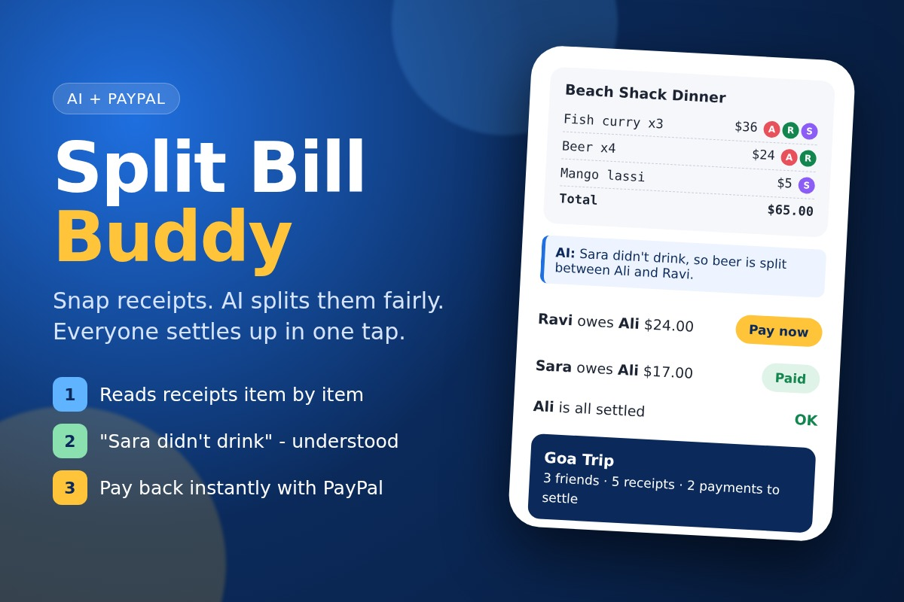

# Split Bill Buddy

**Snap your trip receipts, tell the AI who had what in plain words, and everyone settles up with one PayPal tap.**

Built for the PayPal AI Hackathon. License: [MIT](LICENSE).



## The problem

After a trip with friends, someone always ends up typing receipts into a spreadsheet, arguing over
"I didn't drink, why am I paying for beer?", converting foreign currency, and then chasing people for money.

## What it does

1. **Create a trip** and add friends (with the PayPal email where each person receives money).
2. **Upload a receipt photo.** The AI reads every line item, tax, tip, total and currency, in any language.
3. **Say what's special in normal words**, for example *"Sara didn't drink beer. Sunscreen was only for Ali."*
   The AI decides who shares each item and explains why.
4. **Plain code does the money math**: whole cents, tax/tip shared in proportion, foreign currency converted,
   totals that always add up exactly.
5. **Settle up**: the app works out the fewest payments needed, and each friend pays with a **PayPal** button.
   The money goes straight to the person who paid the bill.

## How PayPal is used

- **PayPal JavaScript SDK** renders a Pay button for every debt ("Ravi pays Ali USD 24.00").
- **Orders API v2** (`intent: CAPTURE`): the server creates an order whose **payee is the friend who is owed money**,
  and captures it after the payer approves. See [`app/paypal.py`](app/paypal.py).
- Completed captures are recorded, and balances update straight away.
- Everything runs in the **PayPal sandbox** (test money).

## How AI is used

| Tool / model | What it does |
|---|---|
| **Google Gemini** (`gemini-3.5-flash`, via the `google-genai` SDK) | 1) Reads receipt photos into structured JSON (items, tax, tip, total, currency, confidence). 2) Turns the plain-English instruction into a per-item "who shares this" plan, with a reason for each item. See [`app/ai.py`](app/ai.py). |
| **Devin (Cognition AI)** | AI coding assistant used to help write and test the code. |

### Safety by design

- **The AI never does money math.** It only reads and assigns; [`app/split.py`](app/split.py) does all arithmetic in integer cents.
- **The AI's output is checked** ([`app/checks.py`](app/checks.py)):
  - If items + tax + tip don't match the total, or the photo was hard to read, a warning is shown.
  - **Blurry photos:** a plain image-sharpness check (Pillow, no AI) warns "please upload a clearer photo". If the AI's confidence is below 0.5, the receipt is rejected instead of guessed.
  - **Manual cross-check:** every receipt has **Check & fix**. You compare it with the photo, correct any item, tax or total, and the code recalculates the shares. It then shows "✓ Checked by you".
  - Unknown names, or items with nobody assigned, fall back to "shared by everyone" with a warning.
- **Receipt text is treated as data**, never as instructions.
- **A debt can only be paid if it really exists**, so the server re-checks the amount before creating a PayPal order.

## Run it

Requires Python 3.11+.

```bash
git clone https://github.com/mahmoodshariff123/split-bill-buddy.git && cd split-bill-buddy
python -m venv .venv && source .venv/bin/activate      # Windows: .venv\Scripts\activate
pip install -r requirements.txt
cp .env.example .env        # then add your keys (optional, see below)
uvicorn app.main:app --port 8000
```

Open http://localhost:8000, click **Fill demo trip**, then add a sample receipt.

### Keys

| Variable | Where to get it | Without it |
|---|---|---|
| `PAYPAL_CLIENT_ID`, `PAYPAL_CLIENT_SECRET` | [PayPal Developer](https://developer.paypal.com/dashboard/applications/sandbox) → Apps & Credentials → Sandbox | "Demo" PayPal: payments are simulated |
| `GEMINI_API_KEY` | [Google AI Studio](https://aistudio.google.com/apikey) | Demo AI: only the 3 bundled sample receipts can be read, and they're split equally |

To test PayPal payments, log in to the PayPal popup with a **sandbox personal account** from
Developer Dashboard → Testing Tools → Sandbox Accounts. Put a sandbox account email in a friend's "PayPal email" field so that person receives the money.

## Tests

```bash
pytest -q
```

## Project layout

```
app/
  main.py     web server and API routes
  ai.py       Gemini: read receipt, plan the split
  checks.py   safety checks on AI output
  split.py    money math: shares, currency, balances, fewest payments
  paypal.py   PayPal Orders API (create + capture), plus offline demo client
  store.py    simple JSON storage
static/       web page (HTML/CSS/JS, PayPal JS SDK)
samples/      sample receipt photos and their generator
tests/        unit and end-to-end tests
```

## What's next

Group chat bot (WhatsApp/Telegram), recurring roommate bills, PayPal payment reminders, live FX rates.
